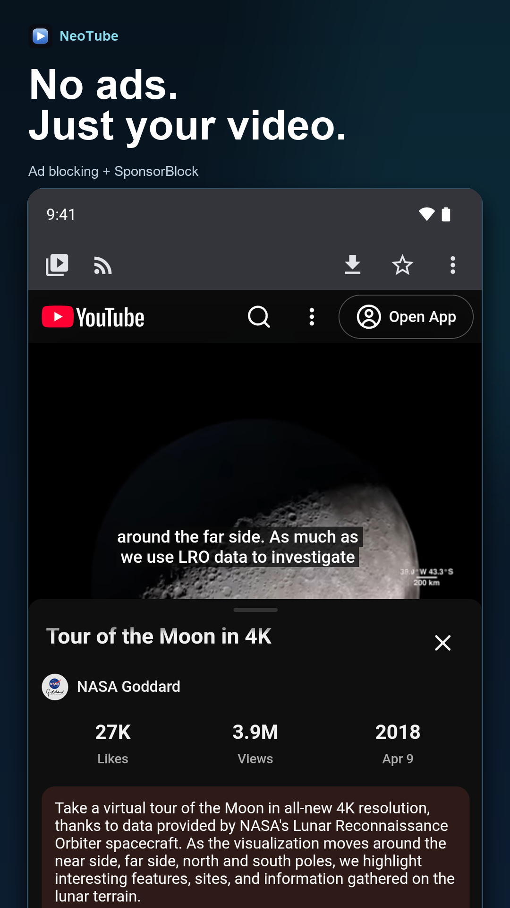
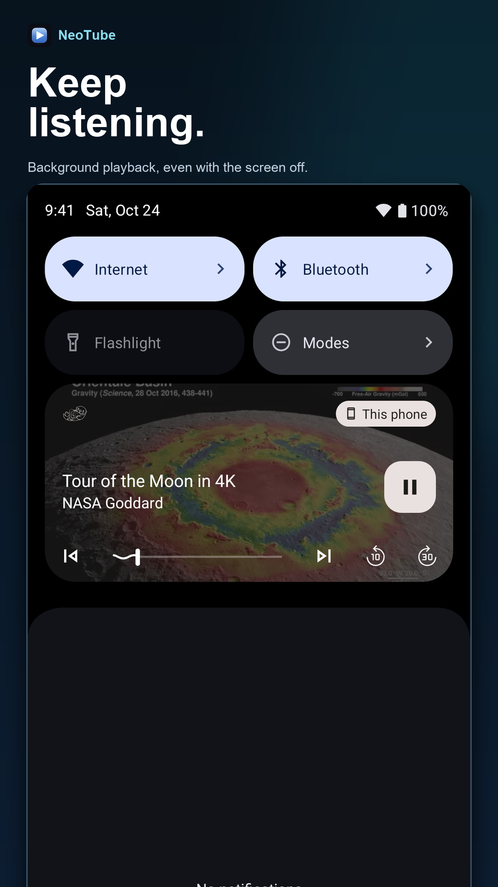
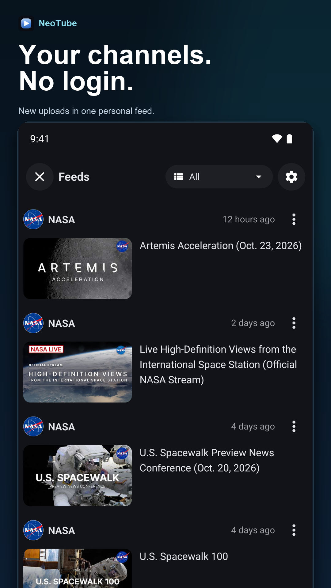
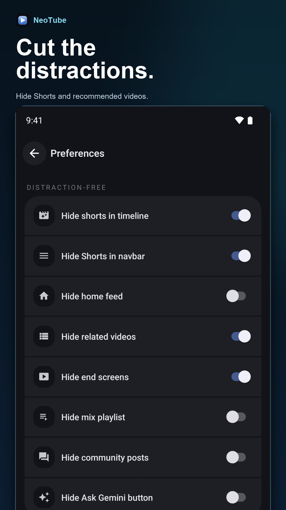
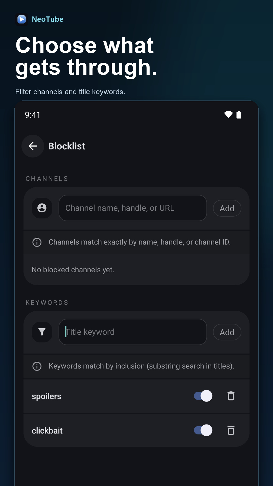
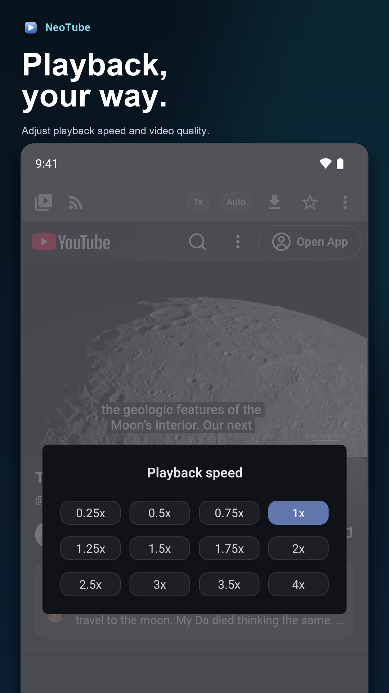

# NeoTube

NeoTube is a fork of [NouTube](https://github.com/nonbili/NouTube) by nonbili, licensed under AGPL-3.0 like the original. It adds a Liquid Glass look and one accent color with four themes: Aurora (default), Crimson, Purple and Cappuccino. Pick them in Settings, under Theme.

Native screens use a glass surface (`components/glass/GlassSurface.tsx`): real blur on iOS and web, a tinted translucent fill on Android. The accent is chosen with colored dots in Settings, and there is a new icon set in `assets/images/`.

Changes from upstream: app name and package id (`dev.neotube.app`), accent palettes (`lib/accent.ts`), the glass CSS injected into YouTube (`lib/glass-css.ts`), and the settings for both. The `ytm-*` selectors in the glass CSS follow YouTube's mobile markup and may need adjusting when it changes.

## Install

Android: take the `.apk` from this repository's Releases tab and sideload it. The build is
arm64-only (`NeoTube-<version>-arm64-v8a.apk`, and its version code is `<versionCode><abi>` —
`8400` plus the ABI digit); other architectures need their own build, see
[RELEASING.md](RELEASING.md). NeoTube keeps its own version numbers from 0.1.0, independent of
the upstream NouTube version it is built from. The app is not on any store, so updates are
manual unless you add the release feed under Settings.

## Keeping up with NouTube

`scripts/sync-upstream.sh check` lists what NouTube has added and which files both sides changed. `scripts/sync-upstream.sh merge` merges it into a new branch. The `Upstream sync` workflow does this weekly and opens a pull request, or an issue if there are conflicts. Most of NeoTube's own code is in `lib/fork.ts`, `lib/accent.ts`, `lib/glass-css.ts` and `components/glass/`, so conflicts should stay small.

## Privacy and sync

See [PRIVACY.md](PRIVACY.md). NeoTube is not connected to NouTube's sync service.

## Building (Android)

`build-neotube.bat` rebuilds the injected content script and then calls Gradle. It uses a
Gradle distribution already cached on disk when one is present and falls back to the
repository's wrapper otherwise; the wrapper has to reach `services.gradle.org` on first use.
`JAVA_HOME` and `ANDROID_HOME` are honoured, or the usual install locations are tried.

```bash
build-neotube.bat assembleFullRelease   # standalone APK, JS bundled
build-neotube.bat assembleFullDebug     # ~20s, loads JS from Metro
```

Things that will otherwise cost an afternoon:

- `android/` is generated. `expo prebuild` rewrites `gradle.properties` and `app/build.gradle`,
  so `reactNativeArchitectures=arm64-v8a`, the release `signingConfig` and the arm64-only
  `splits` block have to be re-applied afterwards. Prefer `--clean`; stop the Gradle daemon
  first or it silently fails to delete the directory and duplicates the plugin's block.
- Do **not** pass `-Pandroid.injected.build.abi`. AGP then packages to a temp location, no APK
  lands in `outputs/`, and installs silently reuse the previous build.
- Check the APK's bundle for a token you just changed before installing anything.
- Keep the Gradle daemon alive. This project's `react {}` block runs a process at
  configuration time, so `org.gradle.configuration-cache` cannot be used.

## Orientation

Portrait everywhere, with one exception: a long-form watch page stays free so the player's own
rotate-to-fullscreen keeps working. The policy lives in `NouController` (`portraitLocked`,
`fullscreenActive`), is applied by `baseOrientation()` in `NouTubeView`, and is set per page from
`MainPageContent`. An explicit fullscreen still forces landscape and restores portrait on exit.

Everything below is the original NouTube README, kept for attribution. Its download links point
at upstream's own F-Droid and GitHub releases, not at this fork.

---

#  NouTube

Android, iOS, and Desktop app for YouTube and YouTube Music.

Install from F-Droid, or download APK from GitHub.

[](https://f-droid.org/packages/jp.nonbili.noutube)
[](https://github.com/nonbili/NouTube/releases/latest)
[](https://testflight.apple.com/join/kkUdF2hV)

Find Linux, macOS, Windows versions in [NouTube-Desktop](https://github.com/nonbili/NouTube-Desktop).

Or use the browser extension on Firefox and Chrome.

[](https://addons.mozilla.org/addon/noutube/)
[](https://chromewebstore.google.com/detail/noutube/cpmippodfdmialcoaegbbmhpdamodoif)

## Features

- No ads
- Plays in the background
- Manage video/music library without login
- Manage watch history without login
- Download video
- RSS feed reader for YouTube channels
- Hide shorts
- Live chat
- Play original audio
- Customize with CSS

## How it works

- Wrap https://m.youtube.com and https://music.youtube.com in Android webview
- Inject code to block ads
- Hook playback controls and support playing in background

## Screenshots

  

  

[Android and iOS store screenshots](metadata/en-US/screenshots/README.md)

## Contributing

You can find [contributing instructions here](/CONTRIBUTING.md)

## Translation

Translation is supported by [Weblate](https://hosted.weblate.org/projects/noutube).

## Note

We're not affiliated with any .org websites.
